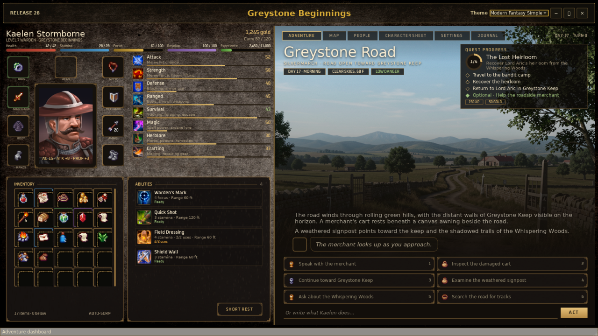
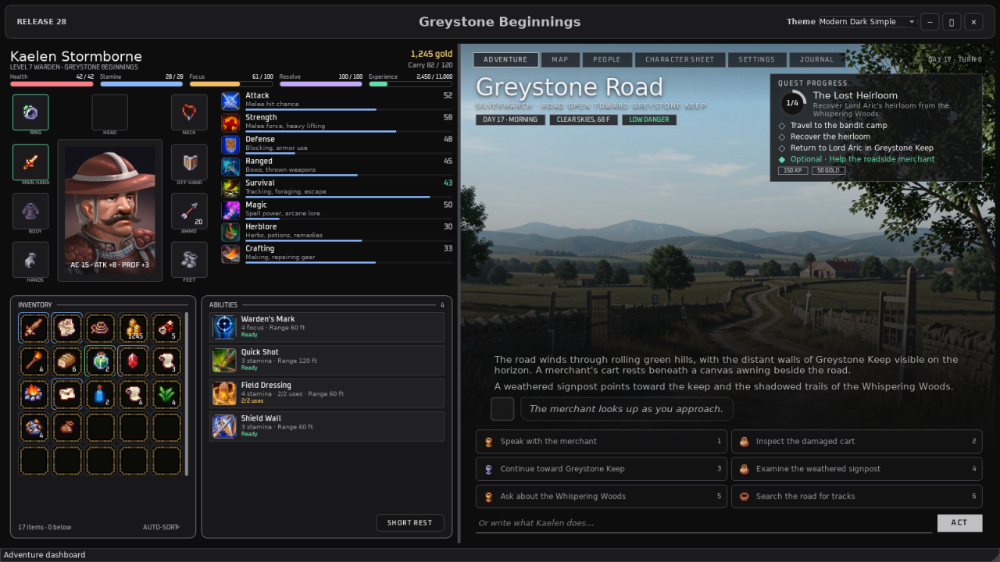
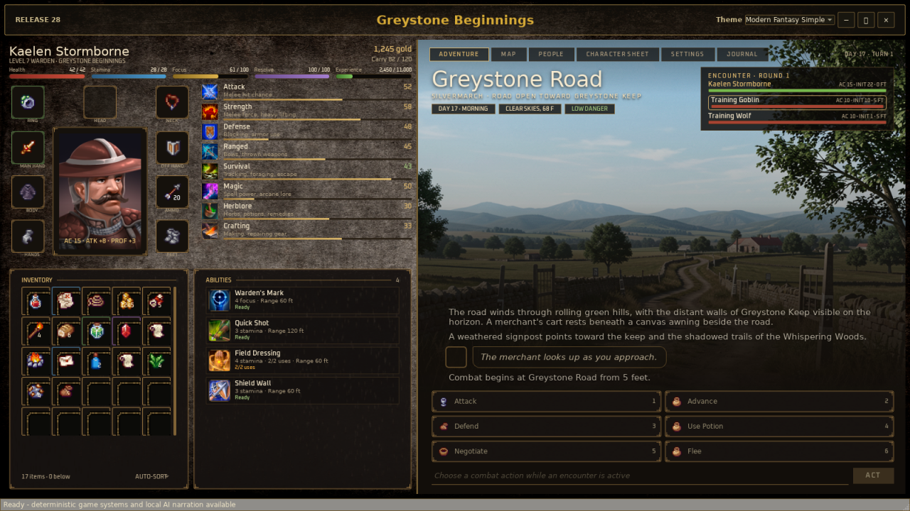
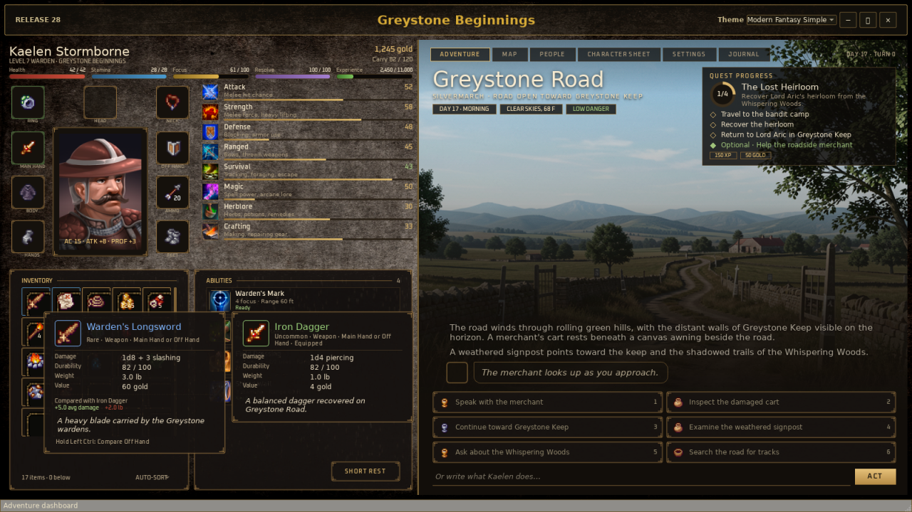
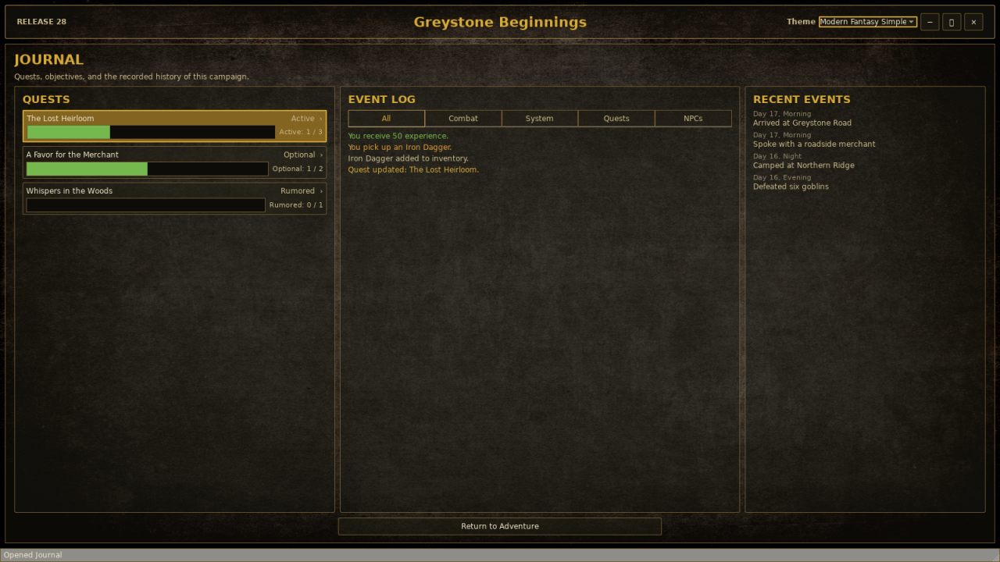
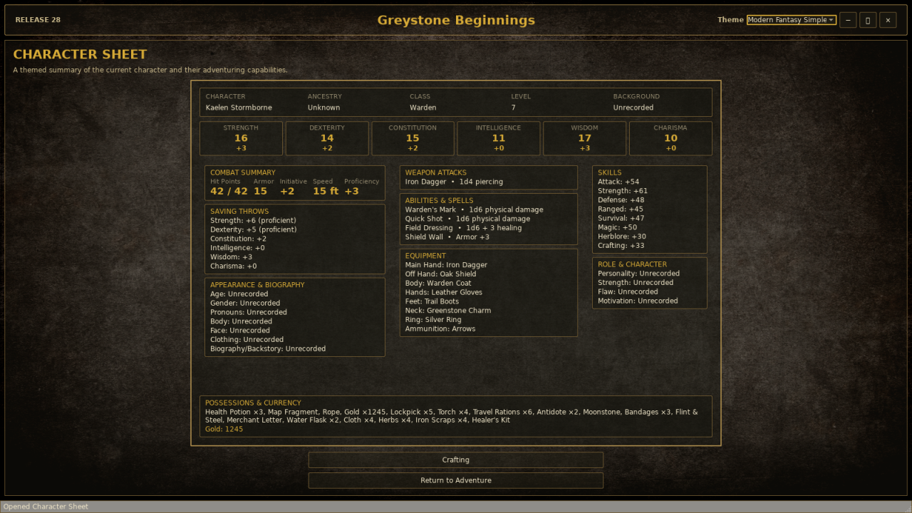

# D&D Simulator — local-first single-player tabletop adventure

## Introduction

D&D Simulator is a Windows desktop game that plays like a solo tabletop role-playing
campaign. A local language model acts as the narrator, but it never runs the rules: every
roll, hit point, item, quest step, and coin is calculated and saved by the application
itself. Nothing leaves your computer.

## Screenshots



*The adventure dashboard: character, inventory, powers and scene.*

| | |
| --- | --- |
| <br>*Dark theme* | <br>*Two-enemy combat* |
| <br>*Item tooltip with comparison* | <br>*Journal* |



*The character sheet.*

## Description

You create a character, pick or generate a campaign, and play by typing what you do.
Each turn follows one bounded loop:

`player action -> bounded state snapshot -> local model proposal -> application validation -> atomic SQLite commit -> UI rebuilt from state`

- **Game-State Ledger** — a versioned SQLite database (schema 21) is the only source of
  truth for campaigns, characters, inventory, combat, quests, NPCs, map, time, and visuals.
- **Local model** — writes narration, dialogue, character suggestions, and typed change
  *proposals*. It cannot touch the database; invalid proposals reject the whole turn.
- **Deterministic systems** — combat (initiative, D&D 5E-style dice, spells, conditions,
  morale), quests with ordered gates, travel and camping, merchants and bartering,
  crafting, levels 1–20 with ability-score improvements, and loot are application code.
- **Recovery** — named checkpoints, pre-migration and pre-load backups, replay checksums,
  safe repair, and an in-memory recovery ledger if the database cannot be opened.

Local AI options:

1. **Bundled llama.cpp** (recommended) — downloads the pinned Qwen3-4B Q4_K_M GGUF
   (2.5 GB, SHA-256 verified, resumable) and runs it on a hidden CPU or Vulkan
   `llama-server`.
2. **Existing GGUF** — uses a model already on disk with the bundled runtime.
3. **Unsloth Studio** (primary external server) — connects to models loaded in Unsloth
   Studio through its authenticated OpenAI-compatible API (suggested for larger models
   such as Gemma 4 E4B Uncensored HauhauCS Aggressive Q8 K P). See
   [`docs/UNSLOTH.md`](docs/UNSLOTH.md).
4. **LM Studio** (secondary external server) — the earlier integration, kept for
   compatibility: local server on port 1234, no API key, native model loading on
   LM Studio 0.4+. See [`docs/UNSLOTH.md`](docs/UNSLOTH.md#lm-studio-secondary-provider).

**Requirements:** Windows 10/11, Python 3.12+ (development), roughly 4 GB free disk for
the recommended model, and a GPU with Vulkan support for fast local inference (CPU works,
slowly). Unsloth Studio is optional.

## Windows application

Run `dist\DnDSimulator\DnDSimulator.exe` beside its `_internal` folder. The similarly
named executable under `build` is a PyInstaller intermediate and cannot run on its own.

- **Local AI Setup** opens on first launch, before any campaign page. The model folder
  defaults to `%LOCALAPPDATA%\DnDSimulator\Models`. **Change Local AI Setup** in Settings
  switches modes later.
- **Campaign selection** lists saved campaigns, the packaged preset
  *The Last Orrery of Sol* (levels 1–5, five chained quests), and **New Campaign**.
- **Character Creation** has four tabs: Local AI Model Selection (required), Character
  Sheet (27-point buy, class hit dice), Campaign (premise, optional full-campaign
  generation), and Final Review with explicit confirmation.
- **Adventure dashboard** — left: character strip, paperdoll, skills with descriptions,
  a scrolling 5 x 5 inventory (up to 320 slots) and an Abilities & Spells card with Short
  Rest. Right: tabs over the location art, a quest or encounter card, a conversation that
  fades into the scene with scroll-back history, and a 2 x 3 choice grid. Item, ability
  and skill tooltips share one card style. The Journal tab holds the event log and quests;
  crafting is on the Character Sheet. Splitters are draggable and saved.
- **People, Map, Character Sheet, Settings** — NPC conversations and trade, route travel,
  the live sheet, and model selection, evaluation, checkpoints, repair, diagnostics
  export, theme (Modern Fantasy Simple / Modern Dark Simple), and font scaling (75–150%).

Configuration, `game_state.db`, `preferences.json`, logs, and model-evaluation reports
live in `%APPDATA%\DnDSimulator` unless `DDSIM_CONFIG_DIR` points elsewhere.

## Setup

From PowerShell in this folder:

```powershell
.\scripts\setup.ps1   # create .venv and install the package with dev extras
.\scripts\run.ps1     # run from source
.\scripts\test.ps1    # full pytest suite, ~2 min (offscreen Qt, temp dirs under %TEMP%)
.\scripts\build.ps1   # PyInstaller one-folder build -> dist\DnDSimulator
```

The bundled llama.cpp runtime lives in `vendor\llama_cpp\{cpu,vulkan}` and is packaged
by `DnDSimulator.spec`. Models are never bundled.

To use Unsloth Studio instead:

1. Start Unsloth Studio on a fixed local port, for example `unsloth studio -p 8888`.
2. Create an API key in Unsloth under **Settings → API** (keys start with `sk-unsloth-`
   and are shown once).
3. In Local AI Setup choose **Connect to Unsloth Studio** and enter the port and key.
4. In Settings press **Refresh Models**, select a model, then **Load Selected Model**.

To use LM Studio instead, start its local server on port 1234, choose **Connect to
LM Studio** in Local AI Setup, then use the same Settings controls.

## Packaged smoke tests

The executable accepts `--smoke-test` (start and exit cleanly) and feature smoke
switches such as `--smoke-test-release27`, `--smoke-test-preset-campaign`, and
`--smoke-test-character-creation`. Run them with an isolated config directory:

```powershell
$env:DDSIM_CONFIG_DIR = "$env:TEMP\ddsim-smoke"
& .\dist\DnDSimulator\DnDSimulator.exe --smoke-test-release27
```

The full list of historical switches is in
[`docs/RELEASE_HISTORY.md`](docs/RELEASE_HISTORY.md#smoke-test-switches).

## Documentation

| Document | Contents |
| --- | --- |
| [`PROJECT.md`](PROJECT.md) | Goal, existing work, remaining phases (development plan) |
| [`PROJECT_RULES.md`](PROJECT_RULES.md) | Rules every change must follow |
| [`HANDOFF.md`](HANDOFF.md) | Current state and next steps for the next session |
| [`docs/UNSLOTH.md`](docs/UNSLOTH.md) | Unsloth Studio API boundary and request contracts |
| [`docs/RECOMMENDED_UNSLOTH_SETTINGS.md`](docs/RECOMMENDED_UNSLOTH_SETTINGS.md) | Model load and evaluation guidance |
| [`docs/GAME_STATE_LEDGER.md`](docs/GAME_STATE_LEDGER.md) | SQLite schema history and boundaries |
| [`docs/DECISIONS.md`](docs/DECISIONS.md) | Decision record and open decisions |
| [`docs/WORKFLOW_STATUS.md`](docs/WORKFLOW_STATUS.md) | Release vs. Workflow Step status |
| [`docs/RELEASE_HISTORY.md`](docs/RELEASE_HISTORY.md) | Per-release behavior notes |
| [`docs/RESOURCE_MAP.md`](docs/RESOURCE_MAP.md) | Source design documents and constraints |
| [`docs/PACKAGING.md`](docs/PACKAGING.md) | Build and first-run notes |
| [`docs/ASSET_CREDITS.md`](docs/ASSET_CREDITS.md) | Asset terms before redistribution |
| [`docs/reference/`](docs/reference/) | PDF/text copies of the original design documents |

## Safety and recovery

- The model never writes to SQLite. Proposals are validated against an operation
  allowlist and stable IDs; any invalid field rejects the entire turn.
- Every accepted turn commits narration, state changes, audit row, and event in one
  transaction; failures roll back and keep the player's text for Retry.
- Malformed model output gets one bounded format retry; mechanical paths then fall back
  to deterministic text and intents.
- All model endpoints must be `localhost`/`127.0.0.1`/`::1`; other hosts are rejected.
- Schema migrations are append-only and back up file-backed ledgers first.
- Checkpoint load and repair create recovery backups before changing state.
- Diagnostics export includes logs and evaluation reports, never campaigns, preferences,
  or API keys.

This project is not a git repository yet. Back up the folder (or run `git init`) before
large changes.
